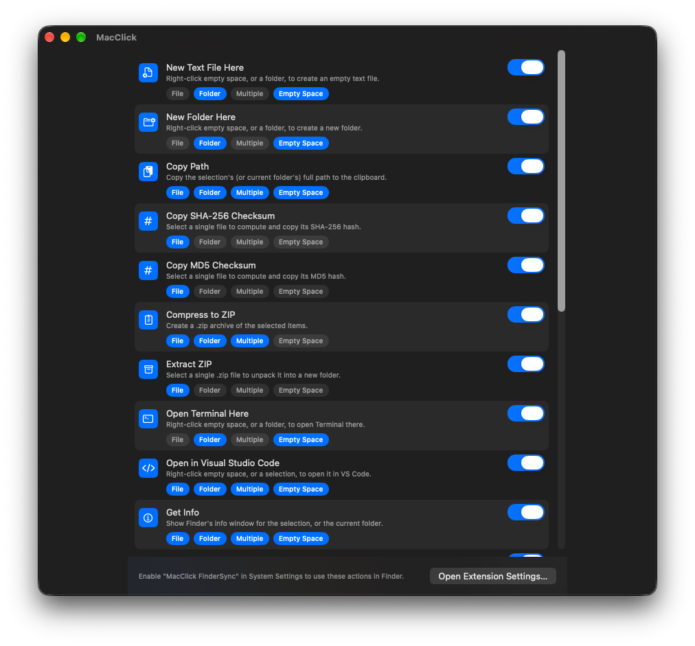
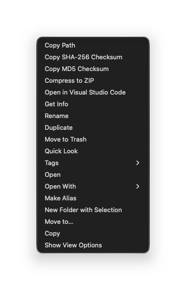
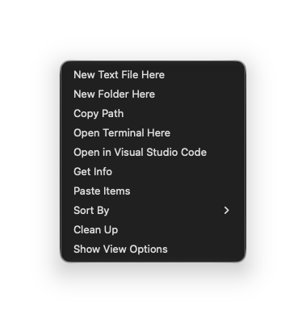

<p align="center">
  
</p>

<h1 align="center">MacClick</h1>

<p align="center">
  The Windows-style right-click menu macOS Finder never had —<br>
  fully custom, down to which action shows where.
</p>

<p align="center">
  <a href="#everything-it-does">Features</a> ·
  <a href="#customize-everything">Customization</a> ·
  <a href="#how-it-works">How it works</a> ·
  <a href="#building">Build it yourself</a> ·
  <a href="#privacy">Privacy</a> ·
  <a href="LICENSE">License</a>
</p>

<p align="center">
  <a href="#building"></a>
  <a href="#building"></a>
  <a href="LICENSE"></a>
</p>

<p align="center">
  
</p>

Right-click a file, a folder, or empty space in Finder and get a menu built from exactly the actions you picked — classic Finder actions like Get Info, Rename, Duplicate, and Move to Trash, alongside things Finder never offered: Copy Path, checksums, Open Terminal Here, Open in VS Code, and more. Every action can be switched on or off, reordered, and scoped to the contexts where it makes sense — a single file, a folder, multiple items, or empty space — all from one settings window.

## Everything it does

### File & folder basics
- **New Text File Here / New Folder Here** — create either right where you clicked.
- **New Folder with Selection** — bundle the selected items into a new folder next to them.
- **Rename** — jumps straight into Finder's own inline rename for the selected item.
- **Duplicate** — a copy of the selection, in the same folder.
- **Move to Trash** — moves the selection to the Trash.
- **Move to…** — pick a destination folder and move the selection there.
- **Copy / Paste Items** — copy a selection, paste it into another folder.
- **Make Alias** — creates a Finder alias for the selection.

### Info & organization
- **Get Info** — opens Finder's own info window for the selection, or the current folder.
- **Tags** — apply a color tag from a submenu, without leaving the menu.
- **Quick Look** — preview the selection without opening it.

### Opening things
- **Open / Open With** — open with the default app, or pick one from a submenu of everything that can.
- **Open Terminal Here** — opens Terminal in the clicked (or current) folder.
- **Open in Visual Studio Code** — same, for VS Code.

### Archives & checksums
- **Compress to ZIP / Extract ZIP** — zip the selection, or unzip a single `.zip`.
- **Copy SHA-256 / MD5 Checksum** — hashes a single file straight to the clipboard.

### Window & view
- **Sort By** — rearrange the current window's icons by name, kind, date, size, or label.
- **Clean Up** — snap icons back to the grid.
- **Show View Options** — opens Finder's own View Options panel.

### Clipboard
- **Copy Path** — copies the selection's (or current folder's) full path.

See [`Shared/Sources/Feature.swift`](Shared/Sources/Feature.swift) for the definitive, always-current list.

## Customize everything

Toggle any action on or off, drag to reorder, and decide exactly where each one shows up: a single file, a single folder, multiple selected items, empty space — any combination. Turn off "Copy Path" for empty-space clicks but keep it for files. Hide checksum actions everywhere except on single files. The defaults match how Finder behaves out of the box; nothing changes until you touch it.

<p align="center">
  
  
</p>
<p align="center"><sub>The same menu on a selected file, and on empty space — each action shows only where you told it to.</sub></p>

## How it works

There's no public API for adding items to another app's contextual menu, so MacClick intercepts the right-click itself — via a `CGEventTap`, before Finder ever receives it — and shows its own menu at the same spot instead. If the click lands on an item that isn't already selected, MacClick reproduces Finder's own selection behavior with a synthetic click first (and leaves an existing multi-selection alone, exactly like a real right-click would). It's built the way Apple would build it otherwise: a native SwiftUI settings app, no private APIs, no process injection.

A `FIFinderSync` Finder Sync extension ships alongside it, ready for the day Apple fixes a platform bug that currently keeps that officially-sanctioned mechanism from running at all; a classic Services-menu fallback also exists for actual selections. Either way, the custom menu above is what you'll actually use day to day.

## Building

MacClick isn't notarized or distributed as a signed build yet — building from source is currently the only way to run it.

`MacClick.xcodeproj` is generated from `project.yml` with [XcodeGen](https://github.com/yonaskolb/XcodeGen) and isn't committed — a generated project file can bake in locally selected signing settings, which must never end up in this public repo.

Before the first build:

1. Accept the Xcode license once, if you haven't already:
   `sudo xcodebuild -license`
2. Copy `Config/Local.xcconfig.sample` to `Config/Local.xcconfig` and fill in
   your Apple Developer Team ID (Xcode → Settings → Accounts → your Apple ID
   → double-click your team; a free personal team works). This file is
   gitignored and is what makes signing survive regeneration — without it,
   Xcode resets the team every time and the build fails because the App
   Group entitlement has no team to provision against.
3. Generate and open the project:

```sh
brew install xcodegen   # once
xcodegen generate
open MacClick.xcodeproj
```

Run `xcodegen generate` again any time `project.yml` or the source file layout changes (for example after pulling new commits).

### Enabling the right-click menu

Finder Sync extensions are never launched directly, and the custom menu needs Accessibility access. After building and running `MacClick.app` once:

1. Grant Accessibility access when prompted (**System Settings → Privacy & Security → Accessibility**).
2. Right-click a file, folder, or empty space in a Finder window to see your enabled actions.

If you also want the dormant Finder Sync extension enabled for when Apple fixes it, turn it on under **System Settings → General → Login Items & Extensions → Finder Extensions**.

## Privacy

MacClick is local-first: no account, no analytics, no telemetry, no network access at all. Reading your selection, moving files, computing a checksum, opening another app — all of it happens on your Mac, through AppleScript calls to Finder or direct file operations.

## License

[MIT](LICENSE), copyright © 2026 Daan Fenske.
